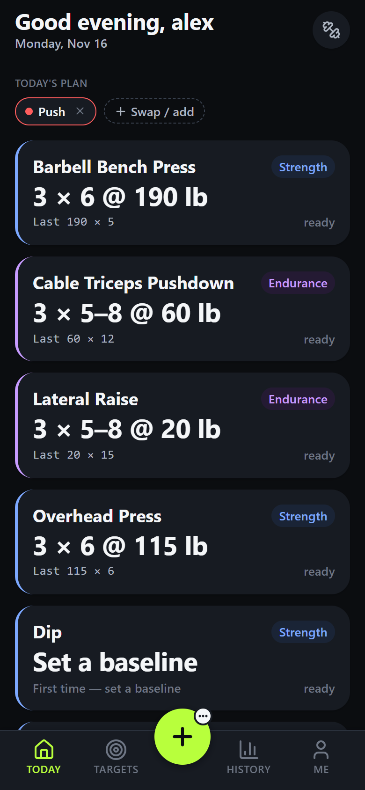
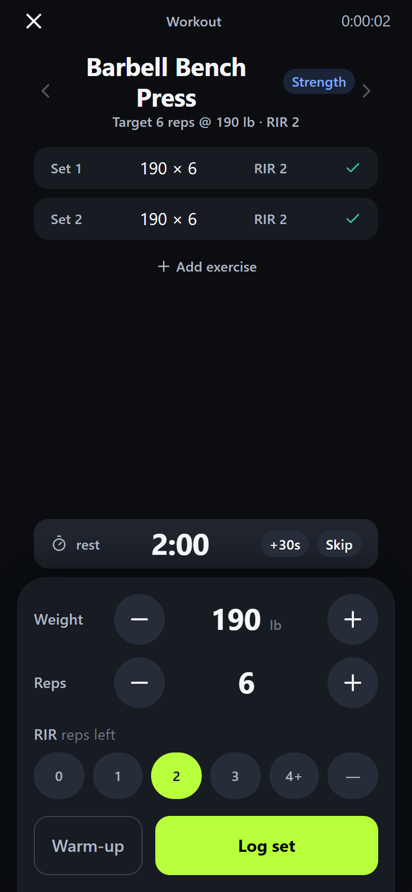
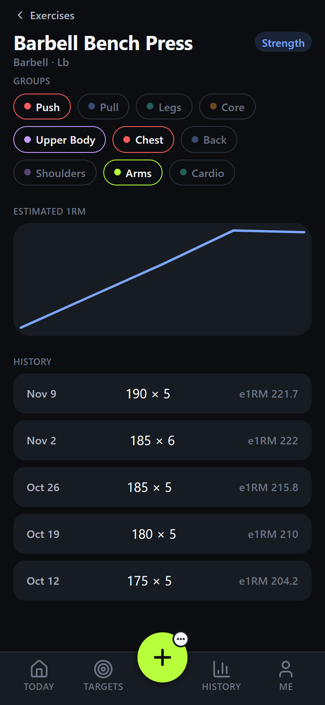

<h1 align="center">Overload</h1>

<p align="center">
  <em>Every session, a little more.</em><br>
  A self-hosted, open-source workout tracker and progression assistant — a mobile-first PWA.
</p>

<p align="center">
  
  
  
</p>

<p align="center">📸 <strong><a href="./portfolio.md">See the full screenshot tour →</a></strong></p>

---

## What it is

**Overload** is a personal workout log that does more than remember what you did. After each session
you record exactly what you performed, and it tells you what to do **next time** to keep getting
stronger, going longer, and lasting more. The name is the principle: *progressive overload*.

## Features

- 📱 **Mobile-first PWA** — installs to the iPhone home screen, one-handed between sets, works offline.
- 🧠 **Progression assistant** — explainable, rule-based recommendations (double progression + RIR for
  strength/endurance, a 10%-cap model for cardio stamina, plus work-capacity progression) tuned to each
  exercise's goal.
- 🏆 **PRs, trends & deloads** — estimated-1RM tracking, stall detection, readiness scaling.
- 🔐 **Invite-only** — the first admin is created from environment variables; others join with a code.
- 🐳 **Self-hosted** — one app container + Postgres, drops into your existing Docker Compose.
- 🌐 **Flexible hosting** — serve the UI from your server, from GitHub Pages, or run it **local-only**
  with no backend (data stays on the device). Configurable API endpoint with health-probe failover
  handles split-DNS home networks.
- ⚙️ **Config via environment variables** — see [`.env.example`](./.env.example).

## Quick start (Docker Compose)

```bash
cp .env.example .env
# edit .env: set SESSION_SECRET, DB_PASSWORD, ADMIN_USERNAME, ADMIN_PASSWORD, ORIGIN
docker compose up -d
```

The app bootstraps the database, seeds a built-in exercise library, and creates the admin account on
first boot. Then sign in, open **Me → Invites** to create invite codes for anyone else.

## Hosting the UI on GitHub Pages

The UI is a static client, so it can be hosted on GitHub Pages while the API +
database stay on your Docker Compose server. On first launch the app asks for
your API address (you can add a fallback, e.g. LAN IP at home + public URL away;
the first one that answers is used). Change it later under **Me → Server**.

1. In the repo: **Settings → Pages → Source: GitHub Actions**. Pushing to `main`
   runs `.github/workflows/pages.yml`, which builds with `npm run build:pages`.
2. On the server, allow the Pages origin (scheme + host, no path) in `.env` and
   restart the stack:
   ```
   CORS_ALLOWED_ORIGINS=https://<your-user>.github.io
   AUTH_TOKENS_ENABLED=true
   ```
3. Open the Pages site and enter your API URL.

> **HTTPS note:** GitHub Pages is HTTPS, and browsers block an HTTPS page from
> calling a plain `http://` API. Chrome allows `http://` **LAN IPs** after a
> "local network access" prompt; Safari/iOS and Firefox do not. For iPhone use,
> give the API an `https://` address — e.g. a public DNS name for a LAN IP with a
> Let's Encrypt cert issued via DNS challenge in NGINX Proxy Manager.

## Connect Claude (MCP)

The server exposes an [MCP](https://modelcontextprotocol.io) endpoint at **`https://<your-server>/mcp`**
so an AI assistant can read your training data and leave comments you'll see in the app.

1. In Claude: **Settings → Connectors → Add custom connector**, paste the URL (also shown under
   **Me → Connected apps**). Claude Code: `claude mcp add --transport http overload https://<your-server>/mcp`.
2. You'll be sent to an Overload sign-in/consent page. Approve, and you're connected.

Auth is OAuth 2.1 (dynamic client registration + PKCE), served by the app itself — nothing to
configure. Permissions: `read` (all your data) and `comment` (add/remove comments). OAuth tokens only
work on `/mcp`, never the app API. Disconnect any client from **Me → Connected apps**.

Tools: `get_profile`, `list_workouts`, `get_workout`, `list_exercises`, `get_exercise_history`,
`get_personal_records`, `get_recommendations`, `get_routines`, `export_all_data`, `list_comments`,
`add_comment`, `delete_comment`. Comments appear on the workout / exercise screens (set comments on
their workout), and general notes under **Me**.

> The server must be reachable from the client over **HTTPS** — for Claude.ai that means publicly
> reachable, since Anthropic's servers make the connection. `ORIGIN` must match the public URL.

## Tech stack

SvelteKit + TypeScript · PostgreSQL + Drizzle ORM · Tailwind CSS · Argon2id auth with cookie **or**
bearer-token sessions · Workbox service worker + IndexedDB offline outbox.

```
src/lib/server/engine/   the progression engine (pure, portable functions)
src/lib/server/services/ data services over the DB
src/routes/api/          JSON API
src/routes/(app)/        the installed app screens
```

## Configuration

Everything operational is an environment variable — no settings UI. See [`.env.example`](./.env.example)
for the full list (core, database, admin bootstrap, app behavior, cross-origin/CORS, optional AI coach).

## License

[MIT](./LICENSE) © 2025 Samuel Ohrenberg
