# Overload: screenshots

A tour of **Overload**, a self-hosted, mobile-first workout tracker. After every session it tells you
exactly what to do next time. The screenshots come from a demo instance with five weeks of seeded
training, captured at iPhone size (390 × 844).

← Back to the [README](./README.md)

---

## Today: the next session is already planned

The home screen reads the weekly routine (Monday is **Push**) and shows a concrete target for every
exercise in it: sets, reps and load, next to what you did last time. Strength, endurance and stamina
exercises use different progression rules, and an exercise with no history asks you to set a baseline.

<table>
  <tr>
    <td align="center">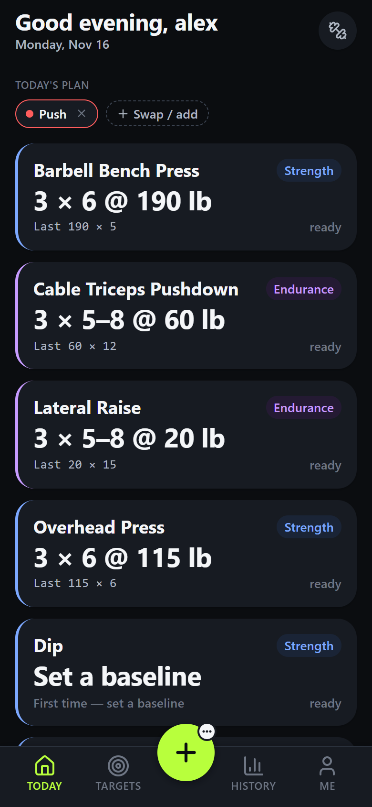</td>
    <td align="center">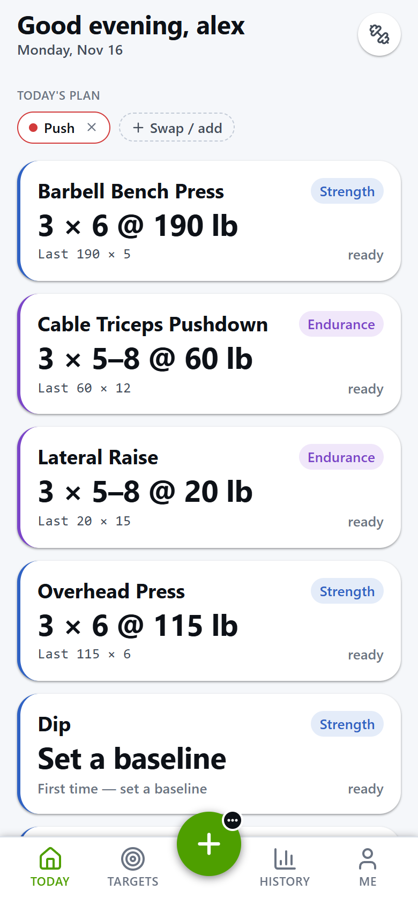</td>
    <td align="center">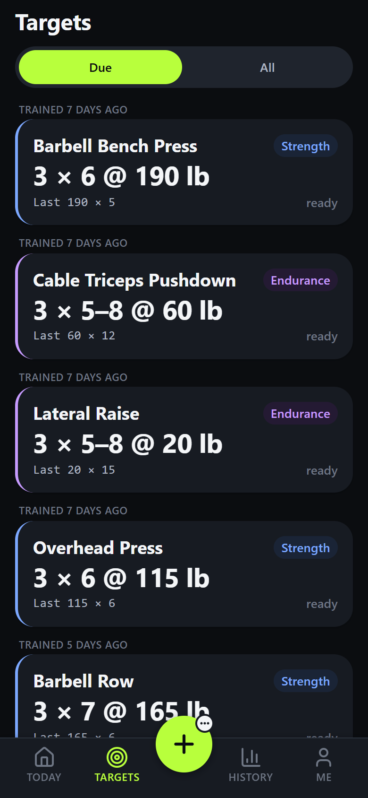</td>
  </tr>
  <tr>
    <td align="center">Today's plan</td>
    <td align="center">Light theme</td>
    <td align="center">Targets: what's due, and how long since you trained it</td>
  </tr>
</table>

## Logging a workout one-handed

The logger opens with the engine's target already filled in, so a typical set takes one tap on
**Log set**. Weight, reps and reps in reserve (RIR) sit in the bottom thumb zone, and a rest timer starts
by itself after each set. Sets are written to an IndexedDB outbox first, so logging still works with
no signal and syncs when the connection returns.

Tap the **+** button to start a workout. Press and hold it to open a quick menu.

<table>
  <tr>
    <td align="center">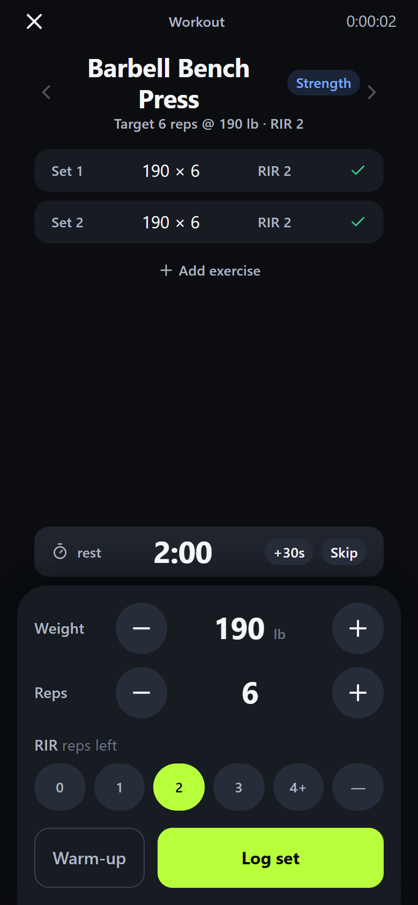</td>
    <td align="center">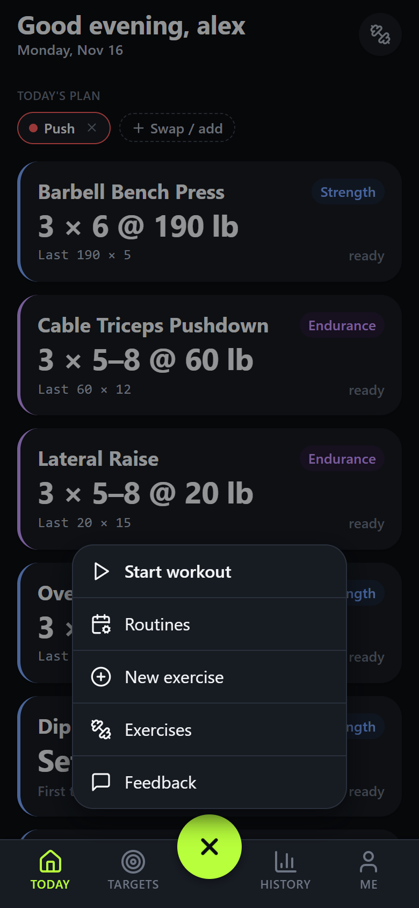</td>
  </tr>
  <tr>
    <td align="center">Set logger with target, rest timer and RIR</td>
    <td align="center">Long-press quick menu</td>
  </tr>
</table>

## Progress you can see

Each exercise has its own trend chart. Strength lifts plot estimated 1RM. Runs are logged as
walk / jog / sprint segments, so the charts track your longest continuous jog and your sprint length.
Personal records get a 🏆 in the session detail.

<table>
  <tr>
    <td align="center">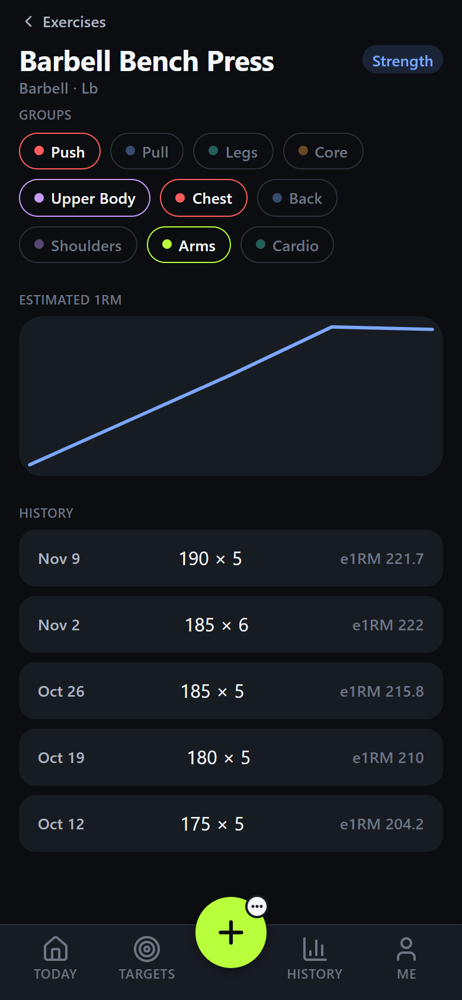</td>
    <td align="center">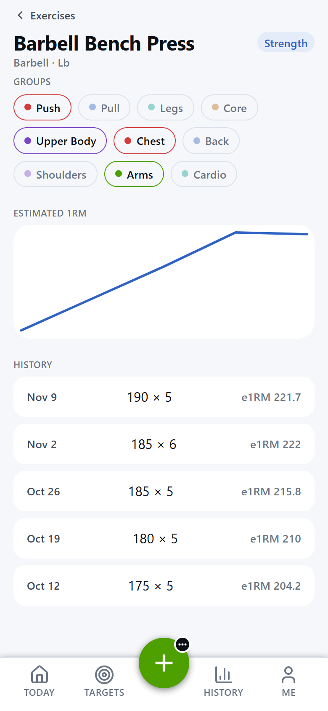</td>
    <td align="center">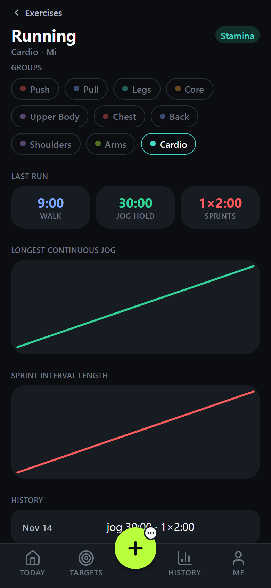</td>
  </tr>
  <tr>
    <td align="center">Estimated-1RM trend</td>
    <td align="center">Light theme</td>
    <td align="center">Runs split into speed zones</td>
  </tr>
</table>

## History, with comments from an AI coach

Overload runs an MCP server with built-in OAuth 2.1, so an assistant such as Claude can read your
training data and leave comments. Those comments show up on the workout they refer to and under **Me**.

<table>
  <tr>
    <td align="center">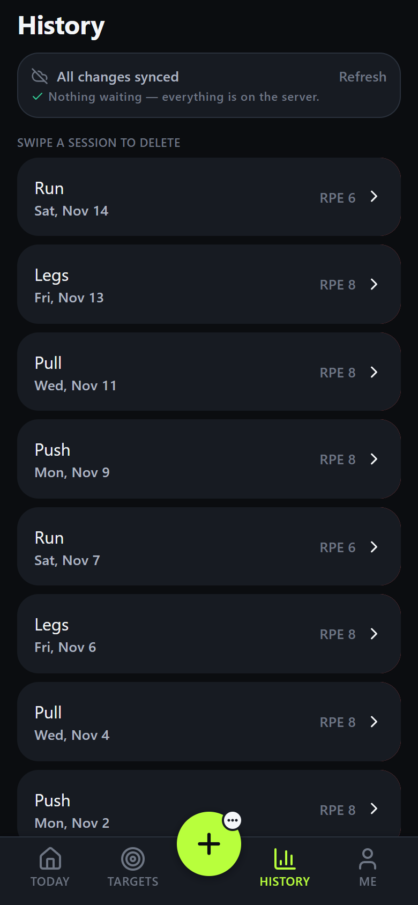</td>
    <td align="center">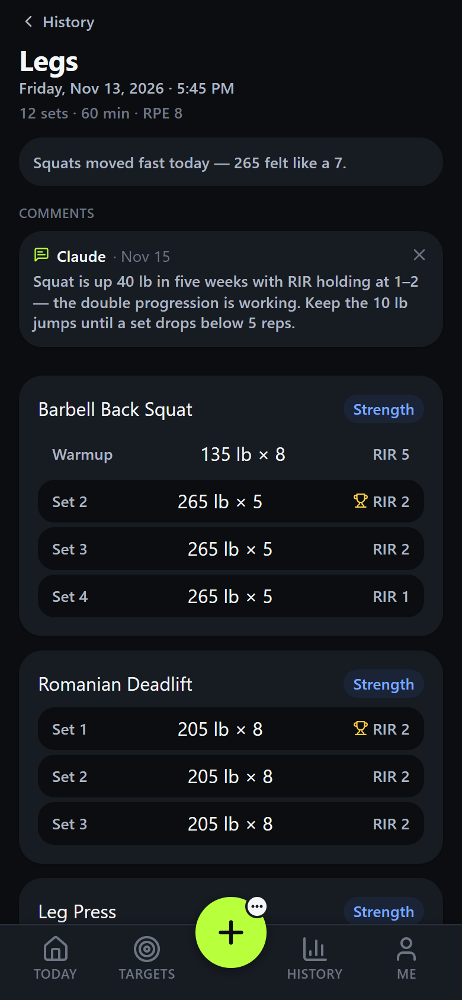</td>
    <td align="center">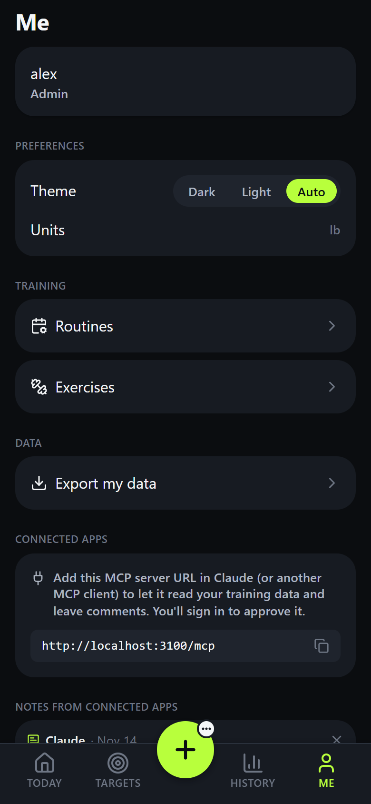</td>
  </tr>
  <tr>
    <td align="center">History and sync status</td>
    <td align="center">Session detail: PRs and a coach comment</td>
    <td align="center">Settings and connected apps (MCP)</td>
  </tr>
</table>

## Routines

Exercises belong to groups (Push, Pull, Legs, Chest, and so on), and one exercise can be in several.
The weekly schedule maps each weekday to groups, which is how **Today** knows what to show. You can
swap a single day without changing the weekly schedule.

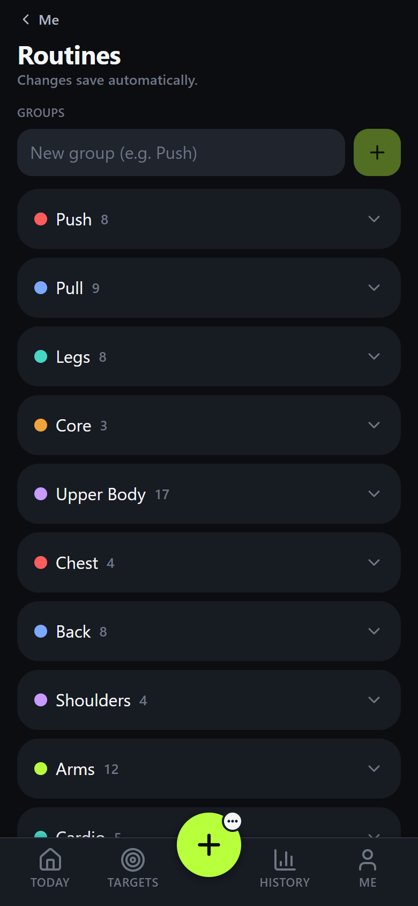

---

## Under the hood

| Area | Built with |
| --- | --- |
| App | SvelteKit 2 · Svelte 5 (runes) · TypeScript · Tailwind CSS |
| Data | PostgreSQL · Drizzle ORM · SQL migrations |
| Auth | Argon2 password hashing · session cookies or bearer tokens · invite-only sign-up |
| Offline | Installable PWA · IndexedDB outbox that queues writes and replays them |
| AI integration | MCP endpoint · OAuth 2.1 with dynamic client registration + PKCE |
| Progression | Rule-based engine you can inspect: double progression + RIR, 10%-cap cardio model, PR and stall detection |
| Deploy | Docker Compose (app + Postgres), or a static UI on GitHub Pages pointed at a separate API |
